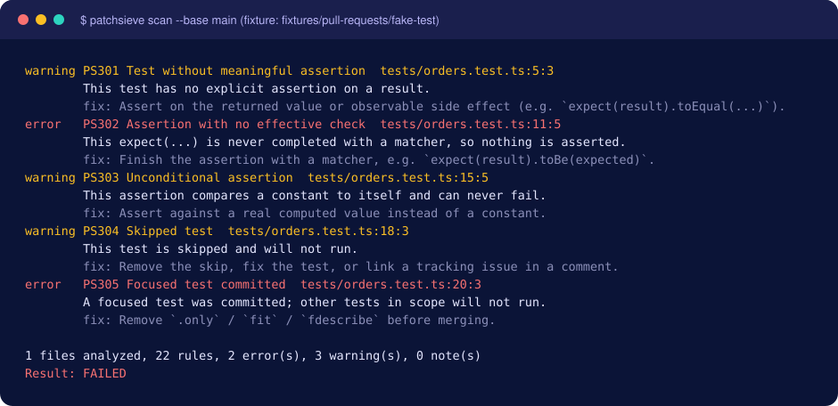

<p align="center">
  <picture><source media="(prefers-color-scheme: dark)" srcset="https://raw.githubusercontent.com/mysterekkk/patchsieve/main/assets/logo.svg"></picture>
</p>

<p align="center">
  <a href="https://github.com/mysterekkk/patchsieve/actions/workflows/ci.yml"></a>
  <a href="LICENSE"></a>
  <a href="https://github.com/mysterekkk/patchsieve/releases"></a>
  
  
  · <a href="README.pl.md">Polski</a>
</p>

# PatchSieve

**Catch what coding agents miss.**

A deterministic quality gate for AI-generated pull requests. Catch suspicious dependencies, swallowed errors, weak tests and risky migrations before they reach `main`.

## The problem

Coding agents can generate large pull requests quickly. Reviewing them consistently takes time, especially when the same classes of defects keep appearing: a test that asserts nothing, an empty `catch`, a function that still says `TODO`, a dependency added to `package.json` but never installed.

## The solution

- **Deterministic.** Same code + same config = same findings. No LLM, no inference API, no API keys.
- **Local-first.** One CLI, one GitHub Action. No server, database, SaaS account or telemetry.
- **Changed-lines-first.** Only what the PR touches is reported; old debt does not block new work.
- **Actionable.** Every finding has a rule ID, exact location, reason, a suggested fix and a docs link.
- **Safe on untrusted PRs.** Static analysis only: PR code is never executed, dependencies are never installed.
- **Open source** (MIT), with a stable rule-ID contract.

## Quick start (GitHub Action)

Listed on the [GitHub Marketplace](https://github.com/marketplace/actions/patchsieve).

Add `.github/workflows/patchsieve.yml`:

```yaml
name: PatchSieve
on:
  pull_request:
permissions:
  contents: read
jobs:
  patchsieve:
    runs-on: ubuntu-latest
    steps:
      - uses: actions/checkout@v7
        with:
          fetch-depth: 0          # needed to find the merge base
          persist-credentials: false
      - uses: mysterekkk/patchsieve@v0.1.0
```

Errors fail the check and appear as annotations plus a Job Summary; warnings are reported without failing. See [docs/github-actions.md](docs/github-actions.md).

## Detected issues

| Group | Rules | Examples |
| --- | --- | --- |
| Dependencies | PS101–PS103, PS104 (opt-in) | new dependency missing from the lockfile; manifest/lockfile range mismatch; `*`/`latest`/floating git refs |
| Error handling | PS201–PS203 | `catch (e) {}`; `promise.catch(() => {})` |
| Tests | PS301–PS305 | test with no assertion; `expect(x);`; `expect(true).toBe(true)`; `it.skip`; `it.only` |
| Stubs | PS401–PS404 | `throw new Error('Not implemented')`; `calculateTotal() { return 0 }`; TODO-only functions; fake `{ success: true }` |
| Reliability | PS501–PS503 | ignored `fetch` response; floating promises; `res.json()` without `res.ok` |
| Migrations | PS601–PS604 | `DROP TABLE/COLUMN`; `ADD COLUMN … NOT NULL` without default; Prisma schema vs migration drift |

Full details, including what each rule deliberately does **not** flag: [docs/rules.md](docs/rules.md).

## Preview

Console report generated by running the built CLI on the `fake-test` fixture (a documentation image rendered from real output, not a screenshot of a GitHub PR):

<p align="center"></p>

## Local CLI

```bash
git clone https://github.com/mysterekkk/patchsieve && cd patchsieve
npm ci && npm run build

node dist/cli.js scan --base main --head HEAD     # analyze a change
node dist/cli.js scan --all                       # whole tree
node dist/cli.js scan --format json
node dist/cli.js scan --format sarif --output report.sarif
node dist/cli.js rules
node dist/cli.js doctor
```

Without cloning: `npx patchsieve scan --base main` (package [`patchsieve` on npm](https://www.npmjs.com/package/patchsieve), needs Node.js 24). Exit codes: `0` passed, `1` findings reached the threshold, `2` configuration/analysis failure. See [docs/cli.md](docs/cli.md).

## Configuration

`.patchsieve.yml` (declarative, schema-validated, never executed):

```yaml
version: 1
scan: { mode: changed, maxFileSize: 1048576 }
rules:
  PS201: error
  PS301: warning
  PS602: warning
ignore: ["**/dist/**", "**/coverage/**", "**/generated/**"]
failOn: error
registry: { enabled: false }
```

Precedence: defaults < config from the **base branch** < CLI flags / Action inputs. A PR cannot weaken its own checks by editing the config or baseline. Details: [docs/configuration.md](docs/configuration.md). Suppress a single finding with a reason: `// patchsieve-ignore PS201 -- cache is optional` ([docs/false-positives.md](docs/false-positives.md)).

## How it works

```
Pull Request → Diff → Parsing → Deterministic rules → Findings → GitHub quality gate
 (merge base)  (+lines)  (TypeScript AST, SQL tokenizer)   (stable IDs)   (annotations, summary, JSON, SARIF)
```

See [docs/architecture.md](docs/architecture.md).

## Security

PatchSieve treats the analyzed change as data. It reads git blobs, refuses symlinks, validates refs and event payloads, escapes workflow commands/terminal/Markdown output, and never runs `npm install`, scripts, tests or migrations from the PR. Use the `pull_request` trigger (not `pull_request_target`); no secrets are needed. Full threat model: [SECURITY.md](SECURITY.md).

## Limitations

Be aware of what this is: pattern-based evidence, not proof.

- No semantic/LLM-level understanding and no type information; heuristics can miss things or flag legitimate code.
- JavaScript/TypeScript for code rules; Prisma and PostgreSQL-style SQL for migrations. Laravel migrations and other languages are not supported yet.
- Offline, the existence of a public package cannot be verified; PS104 is opt-in and a 404 is not proof.
- Quality numbers come from a small hand-built corpus and do not generalize ([docs/benchmarks.md](docs/benchmarks.md)).

More: [docs/limitations.md](docs/limitations.md).

## Roadmap

Not available yet: Python, PHP, Laravel migrations, Go, Rust, deeper dependency analysis, framework-specific rules, opt-in PR comments.

## Contributing

See [CONTRIBUTING.md](CONTRIBUTING.md) and [docs/development.md](docs/development.md) (how to add a rule).

## License

[MIT](LICENSE).

## Author

Built and maintained by **LuroWeb**.

*Need help with automated development workflows?* LuroWeb helps teams build secure development workflows, CI/CD pipelines and custom automation.

## Support

Use GitHub Issues for bugs and false positives.
