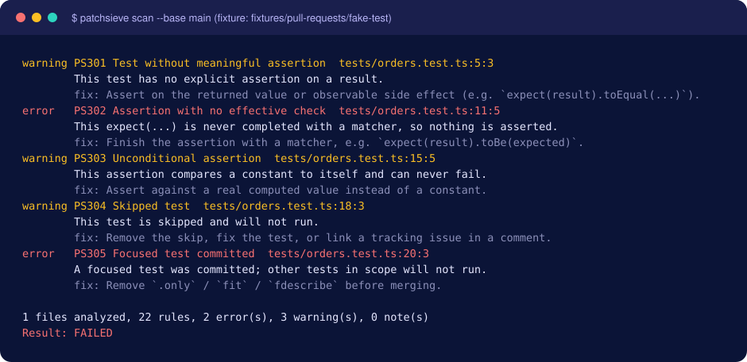
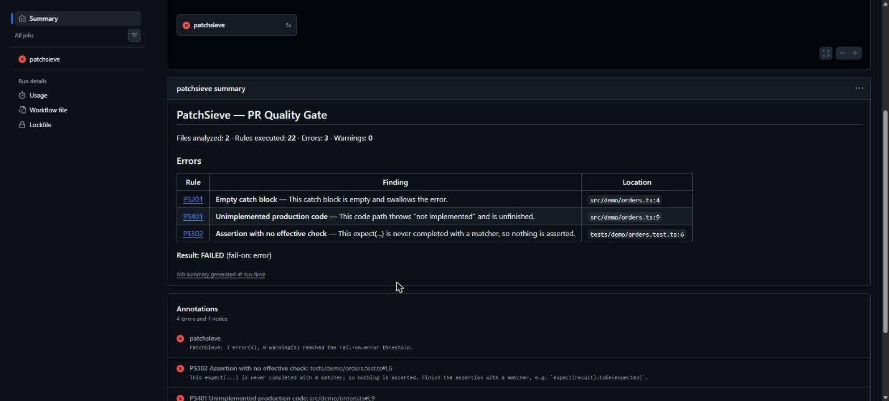
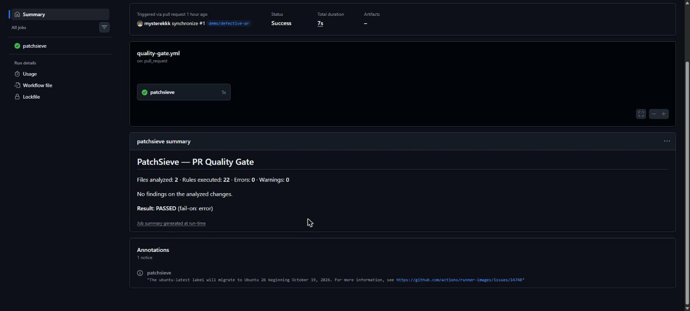

<p align="center">
  <picture><source media="(prefers-color-scheme: dark)" srcset="https://raw.githubusercontent.com/mysterekkk/patchsieve/main/assets/logo.svg"></picture>
</p>

<p align="center">
  <a href="https://github.com/mysterekkk/patchsieve/actions/workflows/ci.yml"></a>
  <a href="LICENSE"></a>
  
  
  · <a href="README.md">English</a>
</p>

# PatchSieve

**Catch what coding agents miss.** (Wyłap to, co przeoczyły agenty kodujące.)

Deterministyczna bramka jakości dla pull requestów generowanych przez AI i ludzi. Wykrywa podejrzane zależności, połknięte błędy, słabe testy i ryzykowne migracje, zanim trafią do `main`.

## Problem

Agenty kodujące szybko generują duże PR-y. Ich spójna recenzja zajmuje czas, zwłaszcza gdy wciąż wracają te same defekty: test, który niczego nie sprawdza, pusty `catch`, funkcja z `TODO`, zależność dodana do `package.json`, ale nigdy niezainstalowana.

## Rozwiązanie

- **Deterministyczne.** Ten sam kod i konfiguracja dają te same wyniki. Bez LLM, bez API inferencji, bez kluczy.
- **Local-first.** CLI i GitHub Action. Bez serwera, bazy danych, konta w SaaS i telemetrii.
- **Najpierw zmienione linie.** Raportowane jest tylko to, czego dotyka PR; stary dług nie blokuje nowej pracy.
- **Konkretne wyniki.** Każde znalezisko ma ID reguły, dokładną lokalizację, powód, sugestię poprawki i link do dokumentacji.
- **Bezpieczne dla niezaufanych PR-ów.** Tylko analiza statyczna: kod z PR nigdy nie jest wykonywany, zależności nie są instalowane.
- **Open source** (MIT) i stabilne identyfikatory reguł.

## Szybki start (GitHub Action)

Akcja jest na [GitHub Marketplace](https://github.com/marketplace/actions/patchsieve).

Dodaj plik `.github/workflows/patchsieve.yml`:

```yaml
name: PatchSieve
on:
  pull_request:
permissions:
  contents: read
jobs:
  patchsieve:
    runs-on: ubuntu-latest
    steps:
      - uses: actions/checkout@v7
        with:
          fetch-depth: 0          # potrzebne do znalezienia merge base
          persist-credentials: false
      - uses: mysterekkk/patchsieve@v0.1.1
```

Błędy (`error`) oblewają sprawdzenie i pojawiają się jako adnotacje oraz w Job Summary; ostrzeżenia są raportowane bez oblewania. Szczegóły: [docs/github-actions.md](docs/github-actions.md) (po angielsku).

## Wykrywane problemy

| Grupa | Reguły | Przykłady |
| --- | --- | --- |
| Zależności | PS101–PS103, PS104 (opcjonalna) | nowa zależność bez wpisu w lockfile; rozjazd zakresów manifest/lockfile; `*`/`latest`/ruchome referencje git |
| Obsługa błędów | PS201–PS203 | `catch (e) {}`; `promise.catch(() => {})` |
| Testy | PS301–PS305 | test bez asercji; `expect(x);`; `expect(true).toBe(true)`; `it.skip`; `it.only` |
| Niedokończony kod | PS401–PS404 | `throw new Error('Not implemented')`; `calculateTotal() { return 0 }`; funkcje tylko z TODO; sztuczne `{ success: true }` |
| Niezawodność | PS501–PS503 | zignorowana odpowiedź `fetch`; „pływające” promisy; `res.json()` bez `res.ok` |
| Migracje | PS601–PS604 | `DROP TABLE/COLUMN`; `ADD COLUMN … NOT NULL` bez domyślnej wartości; rozjazd schematu Prisma i migracji |

Pełny opis każdej reguły, także tego, czego celowo **nie** flaguje: [docs/rules.md](docs/rules.md).

## Podgląd

Raport z konsoli wygenerowany przez zbudowane CLI na fixture `fake-test` (obraz dokumentacyjny z prawdziwego wyjścia programu, nie zrzut ekranu z GitHub):

<p align="center"></p>

## W praktyce

Prawdziwe zrzuty ekranu z jednorazowego demo-PR-a w tym repozytorium (zamkniętego bez merge). Najpierw commit z pustym `catch`, niedokończoną funkcją i asercją bez matchera; potem ten sam PR po poprawkach.

<p align="center"></p>
<p align="center"></p>

## Lokalne CLI

```bash
git clone https://github.com/mysterekkk/patchsieve && cd patchsieve
npm ci && npm run build

node dist/cli.js scan --base main --head HEAD     # analiza zmian
node dist/cli.js scan --all                       # całe drzewo
node dist/cli.js scan --format json
node dist/cli.js scan --format sarif --output report.sarif
node dist/cli.js rules
node dist/cli.js doctor
```

Bez klonowania: `npx patchsieve scan --base main` (pakiet [`patchsieve` w npm](https://www.npmjs.com/package/patchsieve), wymaga Node.js 24). Kody wyjścia: `0` OK, `1` znaleziska osiągnęły próg, `2` błąd konfiguracji/analizy.

## Konfiguracja

Plik `.patchsieve.yml` (deklaratywny, walidowany schematem, nigdy nie wykonywany):

```yaml
version: 1
scan: { mode: changed, maxFileSize: 1048576 }
rules:
  PS201: error
  PS301: warning
  PS602: warning
ignore: ["**/dist/**", "**/coverage/**", "**/generated/**"]
failOn: error
registry: { enabled: false }
```

Kolejność pierwszeństwa: domyślne < konfiguracja z **gałęzi bazowej** < flagi CLI / wejścia Action. PR nie może osłabić własnych kontroli, edytując konfigurację lub baseline. Pojedyncze znalezisko wyciszysz z uzasadnieniem: `// patchsieve-ignore PS201 -- cache jest opcjonalny`.

## Jak to działa

```
Pull Request → Diff → Parsowanie → Reguły deterministyczne → Znaleziska → Bramka jakości GitHub
```

## Bezpieczeństwo

PatchSieve traktuje analizowaną zmianę jak dane. Czyta obiekty gita, odmawia podążania za symlinkami, waliduje referencje i payload zdarzeń, escapuje komendy workflow/terminal/Markdown i nigdy nie uruchamia `npm install`, skryptów, testów ani migracji z PR. Używaj triggera `pull_request` (nie `pull_request_target`); sekrety nie są potrzebne. Szczegóły: [SECURITY.md](SECURITY.md).

## Ograniczenia

- Brak analizy semantycznej na poziomie LLM i brak informacji o typach; heurystyki mogą coś pominąć albo oznaczyć poprawny kod.
- Reguły kodu: JavaScript/TypeScript; migracje: Prisma i SQL w stylu PostgreSQL. Migracje Laravel i inne języki nie są jeszcze wspierane.
- Offline nie da się wiarygodnie sprawdzić istnienia publicznego pakietu; PS104 jest opcjonalna, a 404 to nie dowód.
- Wskaźniki jakości pochodzą z małego, ręcznie zbudowanego zbioru i nie uogólniają się na inne projekty ([docs/benchmarks.md](docs/benchmarks.md)).
- Wykrycie problemu to nie dowód błędu; brak znalezisk nie gwarantuje poprawności kodu.

## Roadmapa (jeszcze niedostępne)

Python, PHP, migracje Laravel, Go, Rust, głębsza analiza zależności, reguły dla frameworków, opcjonalne komentarze w PR.

## Licencja i autor

[MIT](LICENSE). Zbudowane i utrzymywane przez **LuroWeb**.

*Potrzebujesz pomocy ze zautomatyzowanymi procesami wytwarzania oprogramowania?* LuroWeb pomaga zespołom budować bezpieczne workflow deweloperskie, pipeline'y CI/CD i niestandardowe automatyzacje.

Zgłoszenia i fałszywe alarmy: GitHub Issues; pomysły i pytania: [GitHub Discussions](https://github.com/mysterekkk/patchsieve/discussions).
